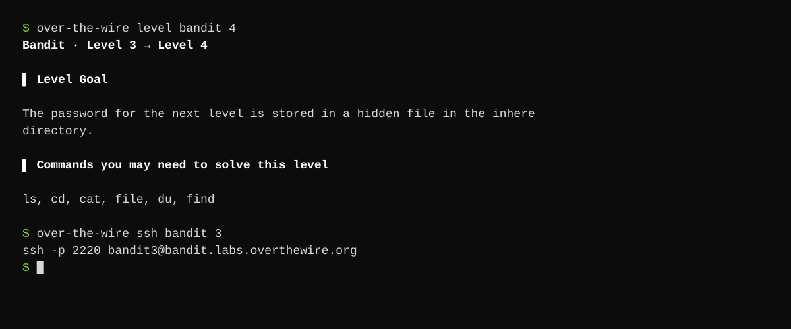

# otw

A Rust CLI for OverTheWire games



## Why this exists

The OverTheWire pages are a website: game lists, level tasks, and rules are
spread across HTML pages, with source files hidden behind a JavaScript call.
This tool puts the whole path in the terminal, offline when needed, and in plain
text that pipes and searches.

## How it works

`overthewire.org/games.json` provides the game list, level counts, SSH hosts,
and ports, including games with special level numbering. Game, level, and rules
pages are downloaded on demand, parsed as HTML, and rendered as width-aware
plain text. Headings, lists, and code blocks stay readable without decorative
markers. Some pages load their source with a `renderCode("...")` call; those
files are fetched too and shown inline, so Vortex and Semtex source is present.

Pages are cached under `$XDG_CACHE_HOME/otw`, normally `~/.cache/otw`. Level
pages last a week and the manifest six hours, and stale copies are used when the
network is unavailable. Search walks every level page, matches
case-insensitively, and prints a snippet around the first hit in each level.
Output is plain text, and every command that makes sense as data has a `--json`
form.

## Usage

```text
otw [OPTIONS] [COMMAND]

Commands:
  games   List every game and its server
  info    Show a game's overview and beginner notes
  levels  List the levels of a game
  level   Show the task for the level you are logged in as
  ssh     Print or run the ssh command for a level
  search  Search the notes of every level
  start   Show the suggested order for playing the games
  rules   Show the game rules
  page    Render any page from overthewire.org
  cache   Inspect or manage the local page cache

Options:
      --offline       Use only locally cached pages
      --refresh       Re-download pages instead of using the cache
      --links         Show link URLs after link text
      --color <WHEN>  Color output: auto, always, or never [default: auto]
  -w, --width <COLS>  Wrap output at COLS columns (0 disables wrapping)
  -h, --help          Print help
  -V, --version       Print version
```

```bash
otw games
otw level bandit 3
otw ssh bandit 3 --run
otw search cron --game bandit
otw --offline level bandit 30
otw cache fetch --all
```

## Notes

Game names are case-insensitive. Levels accept `4`, `bandit4`, `level4`, or
`l4`. `level` takes the level you are logged in as, while `ssh` with no level
defaults to level 0. Natas is web based, so `otw ssh natas 3` prints its URL.

## Config

Optional. Reads `~/.config/otw/config.toml` if present. Flags override the file;
defaults apply otherwise.

```toml
# Output width in columns. 0 disables wrapping.
# width = 100
```

`otw level` also reads `~/.config/otw/credentials.toml` when present and prints
the host, port, username, and password for the level:

```toml
[bandit]
0 = "bandit0"
1 = "..."
```

Passwords stay local; nothing is fetched or uploaded.

## Install

**Requirements:** Rust 1.88+ and `git`.

```bash
cargo install --git https://github.com/batusaribay/otw.git --locked
```

## License

This project is licensed under the [MIT License](LICENSE).
